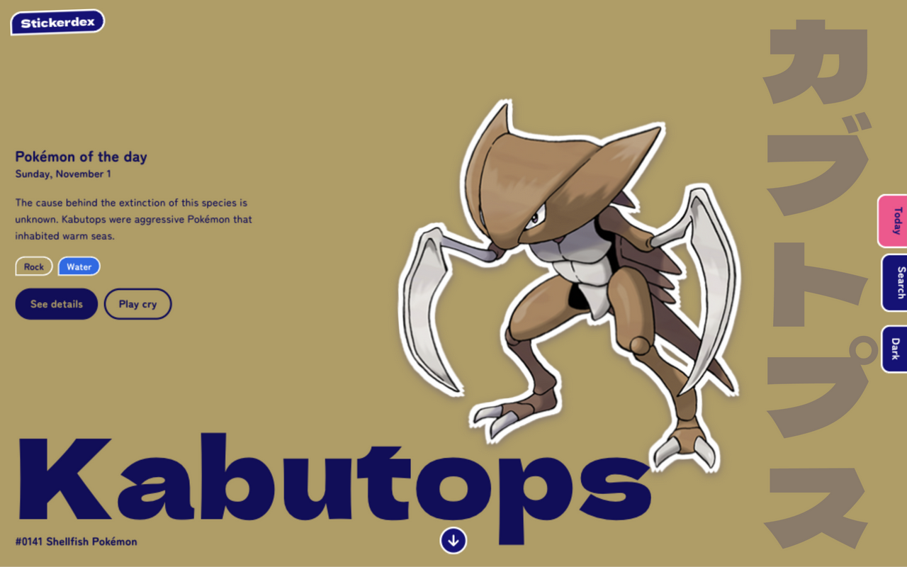
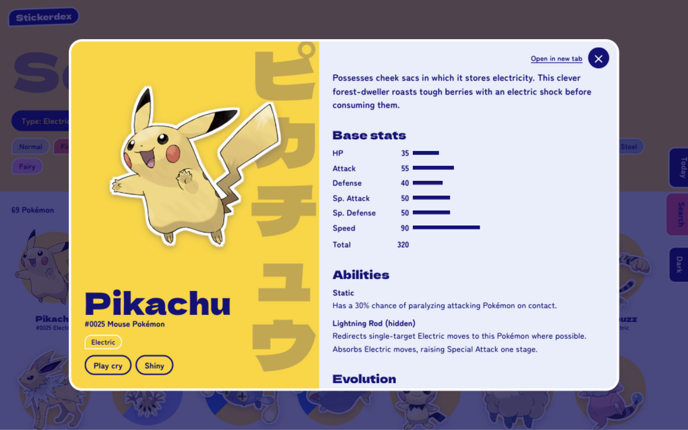
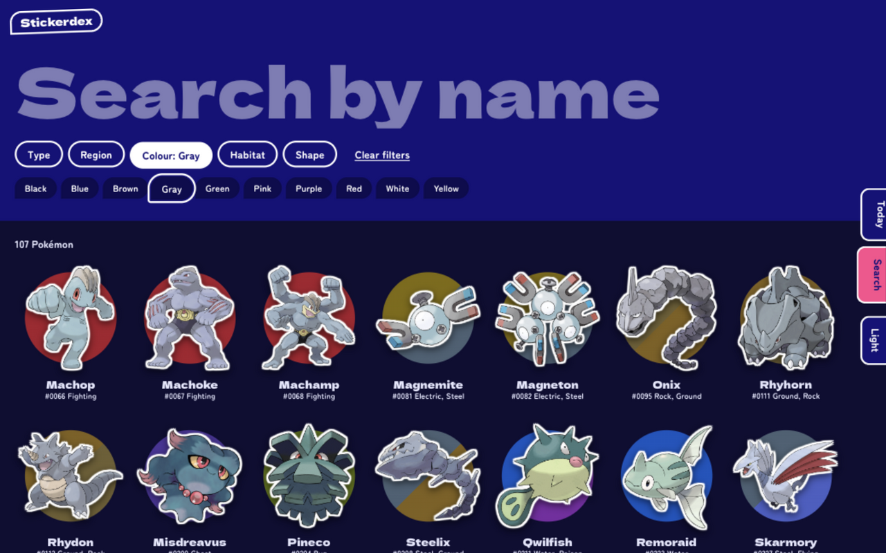
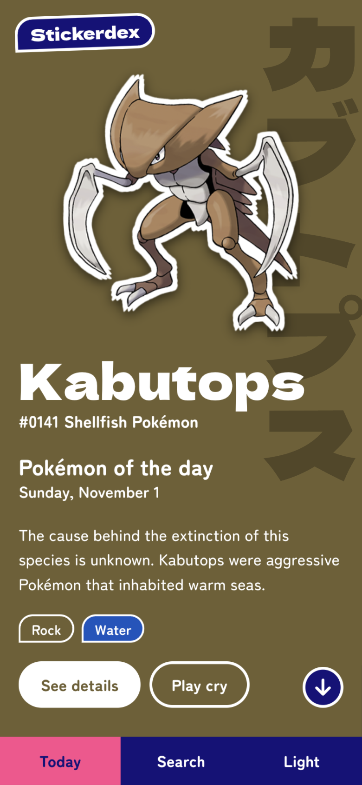
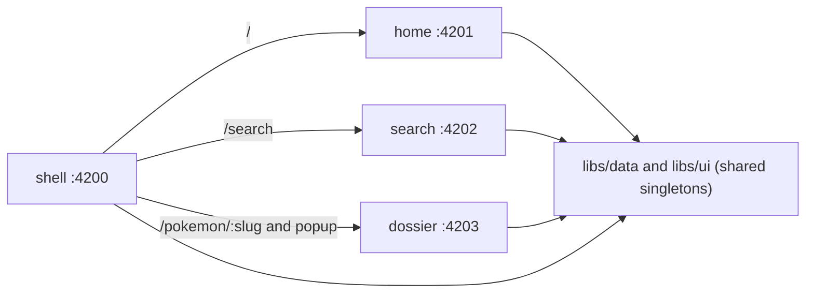

# Stickerdex

A Pokémon browser styled as a Japanese sticker-collecting book (シール帖), built with Angular 21 and an Nx
monorepo of micro frontends. All data comes from [PokéAPI](https://pokeapi.co/).



| Popup                                | Dark mode search                                      | Mobile                                      |
| ------------------------------------ | ----------------------------------------------------- | ------------------------------------------- |
|  |  |  |

## Features

- **Landing page:** Pokémon of the day hero (a new pick each calendar day), Popular carousel, browse by type,
  Legendaries with a holographic foil effect, and regions.
- **Search:** by name or Pokédex number, combined with filters for type, region, colour, habitat and shape.
  Filters live in the URL, so any search can be shared as a link.
- **Popup or page from one URL:** clicking a card opens a popup at `/pokemon/pikachu`. Opening that URL in a new
  tab, or reloading it, shows a full page.
- **Pokémon details:** artwork and shiny artwork, cry, base stats, abilities, evolution chain, damage taken, profile
  and other forms.
- **Dark mode:** a dedicated palette that follows the system setting, with a toggle that remembers your choice.
- **Motion:** the sticker flies from its card into the popup, pages turn in from the binder edge, and the carousel
  enlarges the centred sticker. Reduced-motion preferences are respected.

## Getting started

Requires Node.js `^20.19`, `^22.12` or `>=24`.

```sh
npm install
npm start
```

Open <http://localhost:4200>. `npm start` serves the shell and all three remotes together.

| Command                  | What it does                                                            |
| ------------------------ | ----------------------------------------------------------------------- |
| `npm start`              | Serves every app with live reload                                       |
| `npm run build:vercel`   | Builds and combines every app into `dist/vercel` for one Vercel project |
| `npm run build`          | Builds production bundles to `dist/apps/<app>/browser`                  |
| `npx nx serve <app>`     | Serves one app: `shell`, `home`, `search` or `dossier`                  |
| `npx prettier --write .` | Formats the repo                                                        |

Dev output goes to `dist/dev/`, so `npm run build` is safe while `npm start` is running.

There are no automated tests yet.

## Architecture

The shell loads each remote at runtime with
[Native Federation](https://www.npmjs.com/package/@angular-architects/native-federation), which runs on Angular's
esbuild builder. Nx removed its webpack Module Federation support in v24, so this is the route for Angular 21 on
current Nx.



| Project        | Port | Responsibility                                                       |
| -------------- | ---- | -------------------------------------------------------------------- |
| `apps/shell`   | 4200 | Host: routing, binder tabs, theme, view transitions, scroll handling |
| `apps/home`    | 4201 | Landing page                                                         |
| `apps/search`  | 4202 | Search and filters                                                   |
| `apps/dossier` | 4203 | Pokémon details, exposed as both `./Page` and `./Overlay`            |
| `libs/data`    |      | PokéAPI client and cache, curated lists, popup navigation            |
| `libs/ui`      |      | Sticker components, design tokens, transition CSS                    |

If a remote can't be reached, only its own page shows an error and the rest of the app keeps working. Remotes also
run on their own for working on a single page, but `/pokemon/*` links and popups need the shell.

### How the popup and the page share a URL

Clicking a sticker navigates the router to `<current page>(overlay:pokemon/pikachu)` and passes
`browserUrl: '/pokemon/pikachu'`. The address bar shows the clean URL while the page underneath stays mounted
(`libs/data/src/lib/sticker-overlay.ts`).

- Stickers are real links, so cmd/ctrl/middle click and "Open in new tab" are handled by the browser.
- A fresh load of the URL matches the full-page route.
- Back closes the popup and forward reopens it, because Angular keeps the internal URL in `history.state`.
- A reload would inherit that state too, so `forgetPopupOnFreshLoad()` clears it before the router starts.

### Data and caching

`PokeApi` holds every response in memory for the session. The catalog (one species list plus the 18 type lists) and
filter results are also kept in `localStorage` for 30 days, as PokéAPI's
[fair use policy](https://pokeapi.co/docs/v2#fairuse) asks.

### Theming

Colours are `light-dark()` tokens in `libs/ui/src/styles/global.css`, so the page follows the system with no
JavaScript. The toggle saves a choice to `localStorage` (`apps/shell/src/app/theme.ts`), and a small inline script
in `apps/shell/src/index.html` applies it before first paint. `<meta name="darkreader-lock">` stops the Dark Reader
extension from recolouring the site on top of its own dark theme.

## Deploying

### Vercel, as one project

Import the repository with its root as the root directory. `vercel.json` sets the framework, build command and output
folder, and overrides the Angular preset, which can't find the output of a multi-app workspace.

`npm run build:vercel` builds every app, then `tools/assemble-vercel.mjs` combines them into `dist/vercel`: the shell at
the root and each remote under `/remotes/<name>/`. Remotes are still loaded at runtime. Because the paths are
same-origin, no CORS setup is needed and preview deployments work.

### Hosting each app separately

To release remotes independently, host each `dist/apps/<app>/browser` folder as its own static site:

1. Set the remote URLs in `federation.manifest.json` in the shell's output. No rebuild is needed. The source copy is
   `apps/shell/public/federation.manifest.json`, which points at localhost.
2. Serve `index.html` as the fallback for unknown paths on the shell, so `/pokemon/pikachu` works on a fresh load.
3. Allow cross-origin requests from the shell on each remote (`Access-Control-Allow-Origin`).

## Limitations

- PokéAPI has no popularity data, so Popular and Legendaries are hand-picked in `libs/data/src/lib/curated.ts`.
- PokéAPI has no habitat data after generation 3, so that filter returns no later species.
- Search filters don't include the official category (such as "Mouse Pokémon"), because the API can't list species
  by it. It appears on the details view instead.
- The sticker-to-popup animation needs the View Transitions API. Without it the popup uses a simpler fade and scale.

## License

The code in this repository is available under the [MIT License](LICENSE).

That license does not cover Pokémon content. Pokémon and character names are trademarks of Nintendo, and the artwork
and cries are copyright The Pokémon Company. The app loads them at runtime from PokéAPI's
[sprites](https://github.com/PokeAPI/sprites) and [cries](https://github.com/PokeAPI/cries) repositories, and the
images in `docs/screenshots` show them. This is an unofficial fan project, not affiliated with or endorsed by Nintendo
or The Pokémon Company.

Third-party software, used under its own license:

| Used                                        | License      | How it's used                  |
| ------------------------------------------- | ------------ | ------------------------------ |
| Angular, Native Federation, es-module-shims | MIT          | Included in production bundles |
| RxJS                                        | Apache-2.0   | Included in production bundles |
| tslib                                       | 0BSD         | Included in production bundles |
| Dela Gothic One, Zen Maru Gothic            | SIL OFL 1.1  | Loaded from Google Fonts       |
| [PokéAPI](https://pokeapi.co/)              | BSD-3-Clause | Data, requested at runtime     |
